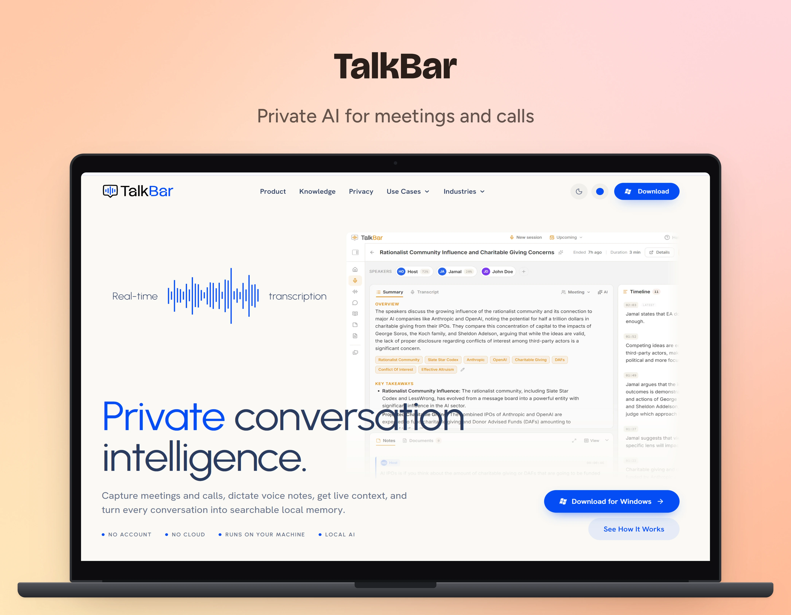
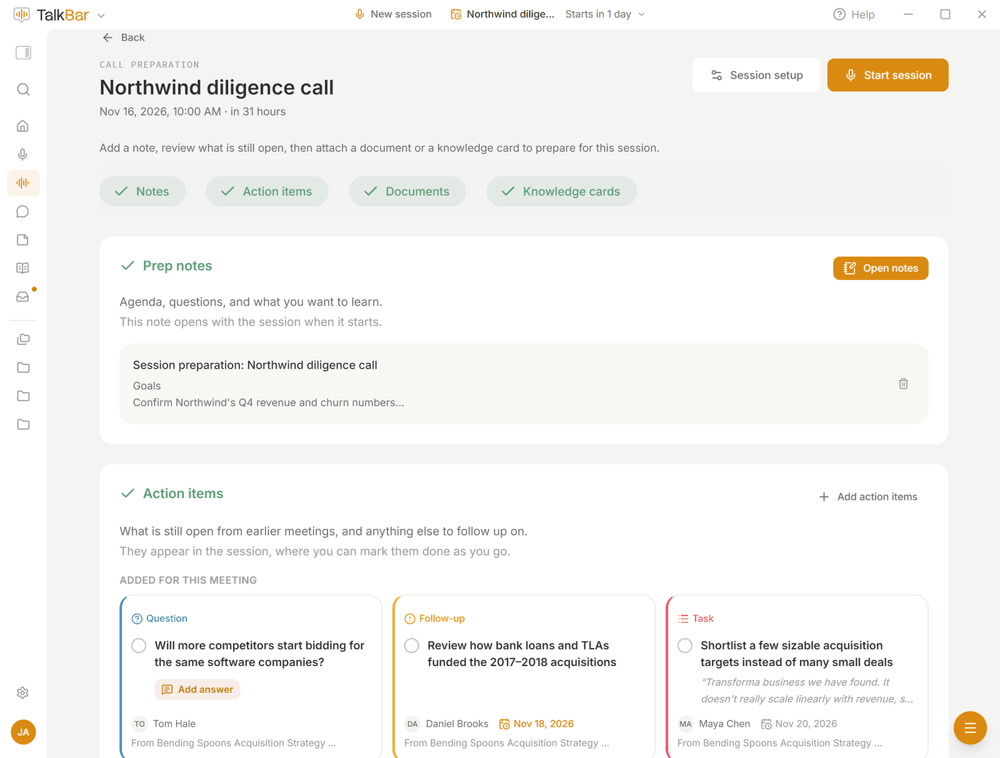
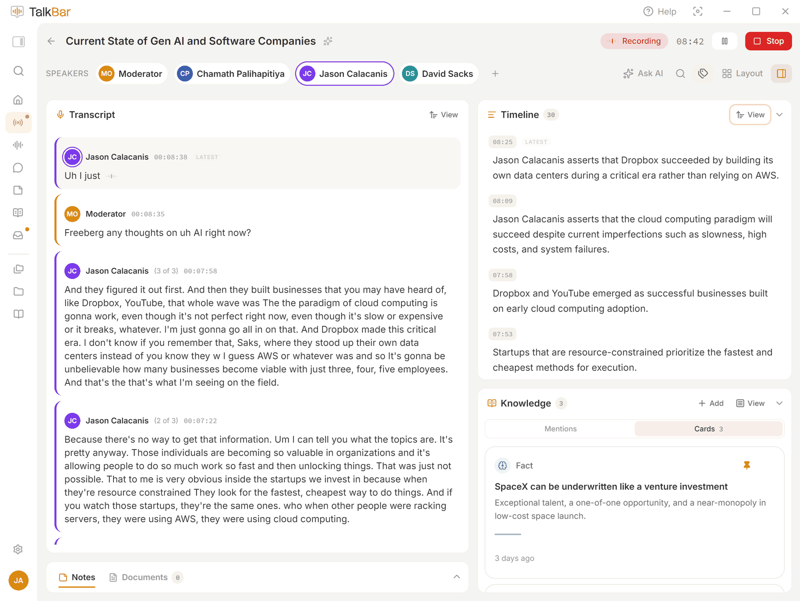
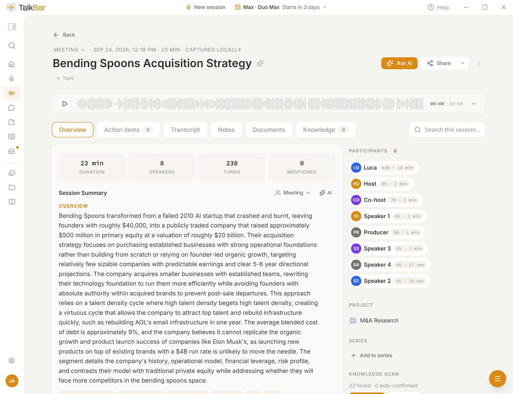
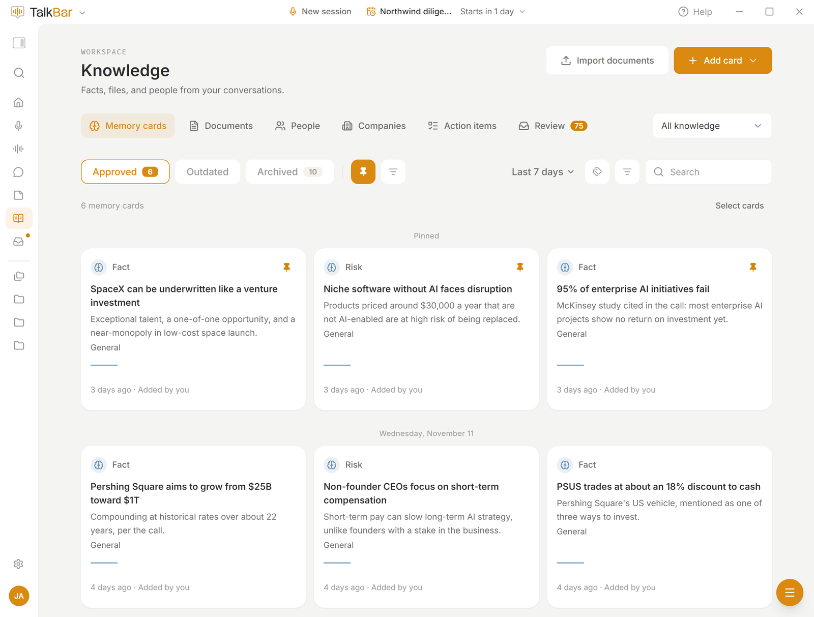

<p align="center">
  <a href="https://www.talkbar.app">
    
  </a>
</p>

<p align="center">
  <strong>Private conversation intelligence for Windows and Mac.</strong><br>
  Capture meetings and calls, dictate voice notes, get live context,<br>
  and turn every conversation into searchable local memory.
</p>

<p align="center">
  <a href="https://github.com/TalkBarApp/talkbar/releases/latest"></a>
  <a href="https://updater.talkbar.app/get/windows/x64"></a>
  <a href="https://updater.talkbar.app/get/windows/arm"></a>
  <a href="https://updater.talkbar.app/get/mac"></a>
</p>

<p align="center">
  <a href="https://download.talkbar.app"><strong>Download</strong></a>
  &nbsp;·&nbsp;
  <a href="https://www.talkbar.app">Website</a>
  &nbsp;·&nbsp;
  <a href="https://docs.talkbar.app/getting-started/introduction">Get started</a>
  &nbsp;·&nbsp;
  <a href="https://docs.talkbar.app">Documentation</a>
  &nbsp;·&nbsp;
  <a href="https://www.talkbar.app/privacy">Privacy</a>
  &nbsp;·&nbsp;
  <a href="https://github.com/TalkBarApp/talkbar/releases">Release notes</a>
</p>

<p align="center">
  <sub>No meeting bot &nbsp;·&nbsp; Local transcription &nbsp;·&nbsp; Local AI or your own key &nbsp;·&nbsp; Your data stays on your computer</sub>
</p>

---

## Why TalkBar

TalkBar is a private AI note taker that records meetings and calls right from your desktop,
using your microphone and your computer's audio. No bot joins the call, and it works with Zoom,
Microsoft Teams, Google Meet, and browser calls.

Transcription runs on your computer. AI can run there too, with a built-in model or Ollama,
or you can bring your own API key when you want a stronger model. Your sessions, notes,
documents, and knowledge stay in one data folder on your machine.

## Before, during, and after every conversation

Prepare before you talk, keep your context in view while you do, and carry what you learned
into the next conversation.

| Before | During | After |
| --- | --- | --- |
| Your agenda and the questions you want answered | Every word captured, with who said it | A clear recap of what was decided |
| The files and facts you'll need, in one place | The right fact surfaces when its topic comes up | Follow-ups with owners, carried into the next call |
| What's still open from last time | Quick answers mid-call, with the source shown | Every conversation, searchable and easy to share |

## Core features

### Capture and prepare

- **Bot-free capture** · record from your desktop with your mic and computer audio. No bot joins.
- **Live context** · a live transcript with speakers, and Knowledge Cards that light up on cue.
- **Preparation page** · agenda, documents, and last time's action items, ready before the call.
- **Scheduling** · plan sessions or bring them in from your calendar, with reminders.
- **Voice notes** · turn spoken ideas, field notes, and reflections into searchable notes.

### Remember and act

- **Summaries and action items** · decisions, open questions, and next steps from every call.
- **Knowledge Cards** · scan meetings and documents, then keep only the facts that matter.
- **Ask TalkBar** · chat with a session, a document, or everything you've kept, with sources.
- **Searchable memory** · every transcript, note, and document, searchable on your computer.
- **Exports your way** · Markdown, HTML, JSON, subtitles, or ZIP, or straight to Obsidian or Notion.

### Run it your way

- **Local AI or your own key** · a built-in model, Ollama, or any provider with your own key.
- **Private AI Mode** · one switch keeps summaries, chat, and knowledge scans on your computer.
- **Templates & Skills** · shape how each session is captured and summarized, and add outputs.
- **MCP & CLI** · let Claude, ChatGPT, Codex, and other MCP clients work with your workspace, locally.

See every feature on [talkbar.app](https://www.talkbar.app/#features).

## See it in action

<!-- Justified rows: the left screenshot and label sit on the left edge, the right ones on the right edge.
     Labels use narrow no-break spaces (&#8239;) so only the gap between the two labels widens.
     The zero-height image ends each row so its label line is justified too. -->
<p align="justify">
  
  
  <b>Before</b>&#8239;·&#8239;Prepare&#8239;the&#8239;call
  <b>During</b>&#8239;·&#8239;Live&#8239;context&#8239;and&#8239;knowledge
  
</p>
<p align="justify">
  
  
  <b>After</b>&#8239;·&#8239;Summary&#8239;and&#8239;action&#8239;items
  <b>Knowledge</b>&#8239;·&#8239;Facts&#8239;that&#8239;last
  
</p>

## Get started

Follow the guided path in the documentation, from download to your first summary:

1. **[Install TalkBar](https://docs.talkbar.app/getting-started/install-and-update)**: pick the installer for your computer. Updates install themselves after that.
2. **[Run first-run setup](https://docs.talkbar.app/getting-started/first-run-setup)**: choose where AI runs and get the speech models ready.
3. **[Record your first session](https://docs.talkbar.app/getting-started/first-session)**: set it up, record, and review the transcript and summary.
4. **[Find your way around](https://docs.talkbar.app/getting-started/getting-around)**: the sidebar, search, Quick Actions, and keyboard shortcuts.

Then go further with [Private AI Mode](https://docs.talkbar.app/ai/private-ai-mode),
[scheduling and preparing](https://docs.talkbar.app/sessions/scheduling-and-preparing),
[Knowledge Cards](https://docs.talkbar.app/knowledge/knowledge-cards),
[Ask TalkBar](https://docs.talkbar.app/chats-and-notes/ask-talkbar), and the
[MCP & CLI guide](https://docs.talkbar.app/mcp). Stuck? See
[troubleshooting](https://docs.talkbar.app/help/troubleshooting) and the
[FAQ](https://docs.talkbar.app/help/faq).

## Download

| Your computer | Requirements | Download |
| --- | --- | --- |
| Windows (Intel or AMD) | Windows 10 or 11, 64-bit | [Windows x64](https://updater.talkbar.app/get/windows/x64) |
| Windows on Arm | Windows 11 on Arm, such as Snapdragon PCs (runs natively) | [Windows Arm64](https://updater.talkbar.app/get/windows/arm) |
| Mac with Apple silicon | M1 or later, macOS 13.4 or later | [macOS (Apple silicon)](https://updater.talkbar.app/get/mac) |

Intel Macs aren't supported. Every installer is also on the [download page](https://download.talkbar.app)
and the [releases page](https://github.com/TalkBarApp/talkbar/releases/latest).

TalkBar updates itself: new versions download in the background and install the next time it
starts. Every update is signed and checked before it installs. To try new features early, turn on
**Beta updates** in **Settings → General**.

## Privacy

TalkBar is local-first and built for sensitive conversations. Each AI feature has its own route,
so you decide what runs where:

| AI path | Where it runs | What leaves your computer |
| --- | --- | --- |
| Built-in model | This computer | Nothing |
| Ollama on this computer | This computer | Nothing |
| Ollama on another computer | That computer | The text of each request, over your network |
| Your own API key | The provider you chose | Only the text the request needs |

Private AI Mode allows only the first two. Audio, transcripts, and notes are never part of
TalkBar's anonymous usage statistics, which you can turn off. Read the full breakdown on the
[privacy page](https://www.talkbar.app/privacy).

> [!NOTE]
> TalkBar removes the meeting bot, not your responsibilities. Recording-consent rules vary by
> region and type of call, so follow the ones that apply to your conversations.

## Built for

**Use cases:** [one-on-one meetings](https://www.talkbar.app/one-on-one-meetings) ·
[coaching sessions](https://www.talkbar.app/coaching-sessions) ·
[interviews](https://www.talkbar.app/interviews) ·
[podcasts](https://www.talkbar.app/podcasts) ·
[voice notes](https://www.talkbar.app/voice-notes) ·
[client calls](https://www.talkbar.app/client-calls)

**Industries:** [venture and private equity](https://www.talkbar.app/venture-private-equity) ·
[legal counsel and M&A](https://www.talkbar.app/legal-counsel) ·
[executive leadership](https://www.talkbar.app/executive-leadership) ·
[B2B sales and customer success](https://www.talkbar.app/b2b-sales) ·
[consultants and advisors](https://www.talkbar.app/consulting) ·
[product research and recruiting](https://www.talkbar.app/product-research)

## About this repository

This repository publishes TalkBar releases and holds the source of the
[documentation site](docs/README.md) (Nuxt) and the [website](website/README.md) (Astro).
Contributors and AI agents: read [AGENTS.md](AGENTS.md) first.

Requires Node.js 22 or newer.

```bash
npm run setup    # install the root tools, docs and website
npm run dev      # docs on http://localhost:8000, website on http://localhost:4321
npm run check    # docs content checks, website tests, lint and type checks
```

Production builds: `npm run build:docs` (into `docs/dist`) and `npm run build:website`
(into `website/dist-prod`). Both sites deploy with Cloudflare Pages from `main`. Deployment,
previews, and translations are covered in the [docs](docs/README.md) and
[website](website/README.md) READMEs.

<p align="center">
  <sub>© 2026 TalkBar. Built for sensitive conversations.</sub>
</p>
